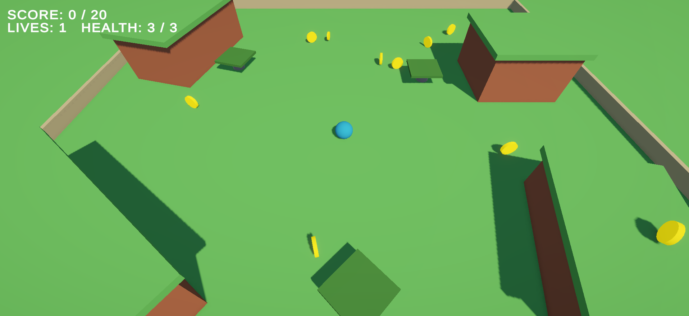
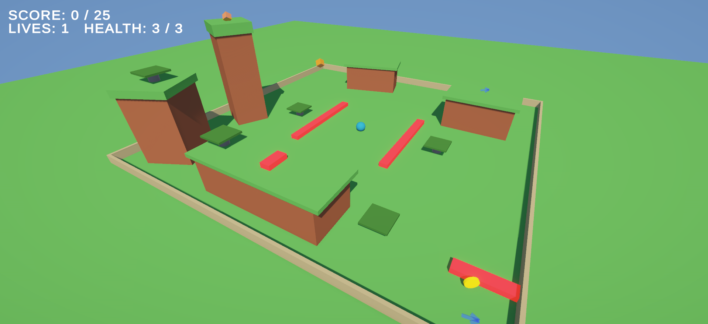
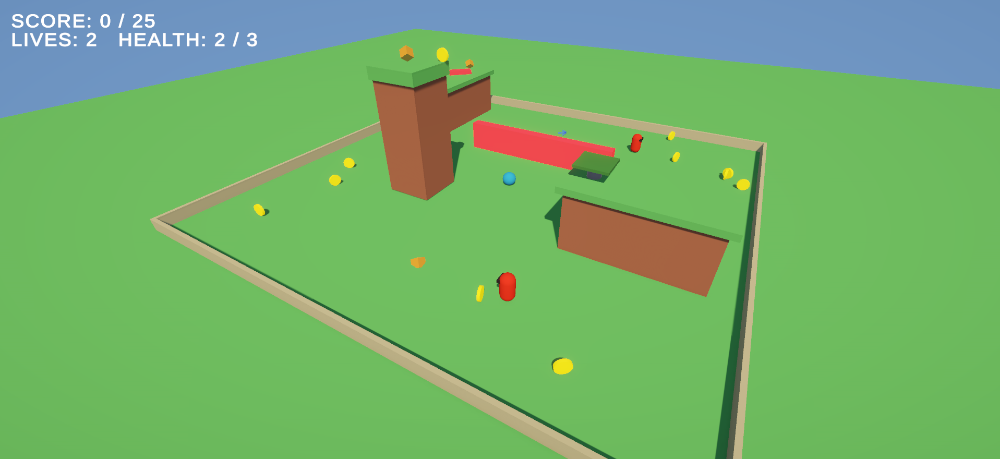
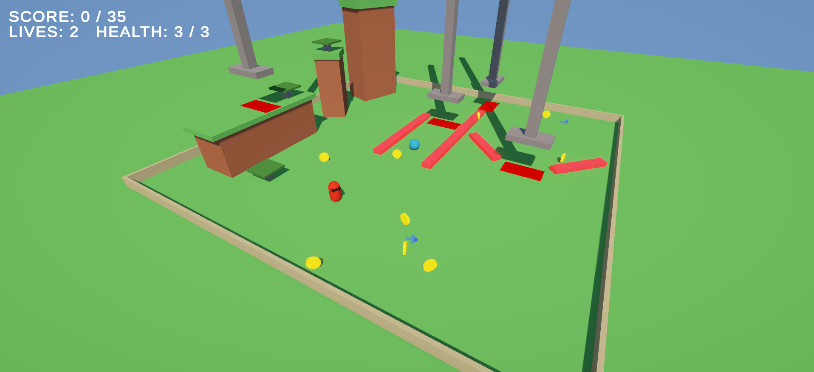
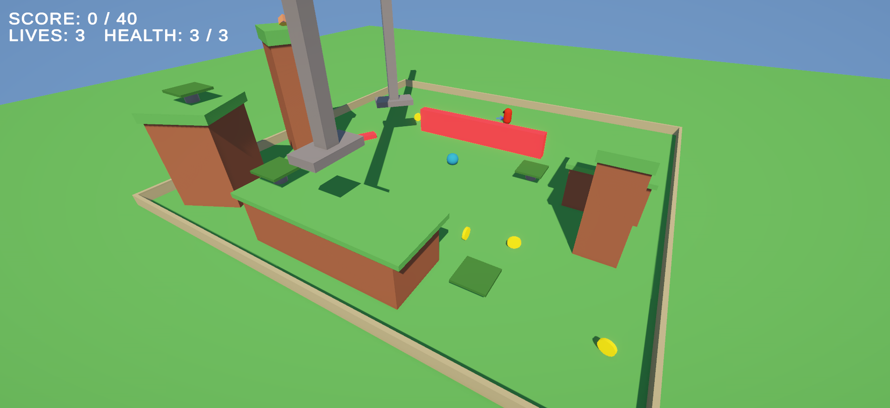

# CS464 Assignment 03 · Abdullah Saeed · BSCS25067
- **Video (60–120 s):** [YouTube (unlisted) or Google Drive link]
- **Started from:** [your Assignment 02 repo's link, or "a new project", and why]
- **Controls:** [the keys]
- **To win a level:** [e.g. collect 8 coins, then reach the goal]
## Levels
| Level | Screenshot | New idea | Combined with |
|---|---|---|---|
| Level01 |  | [new idea] | [combined with] |
| Level02 |  | [new idea] | [combined with] |
| Level03 |  | [new idea] | [combined with] |
| Level04 |  | [new idea] | [combined with] |
| Level05 |  | [new idea] | [combined with] |
## The numbers
| Number | Value | Why this value |
|---|---|---|
| Patrol speed | [m/s] | [e.g. how it compares with your run speed] |
| Chase range | [m] | [e.g. what a guard can and can't see from its route] |
| Knockback | [the number and its ForceMode] | [e.g. how far it throws you, measured in play] |
| I-frames | [s] | [e.g. the time it takes to get clear after a hit] |
| Power-up duration | [s] | [e.g. long enough for what, and not for what] |
## Short answers
**1. Why does a trigger need a Rigidbody on at least one of the two objects?**
[your answer]
**2. Which ForceMode do your knockback and your Part A force use, and why each?**
[your answer]
**3. What does your code do when a second power-up is picked up while one is running?**
[your answer]
**4. Why can `==` fail as an arrival check, and when does it work?**
[your answer]
